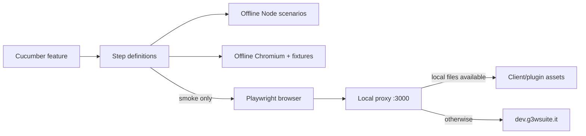
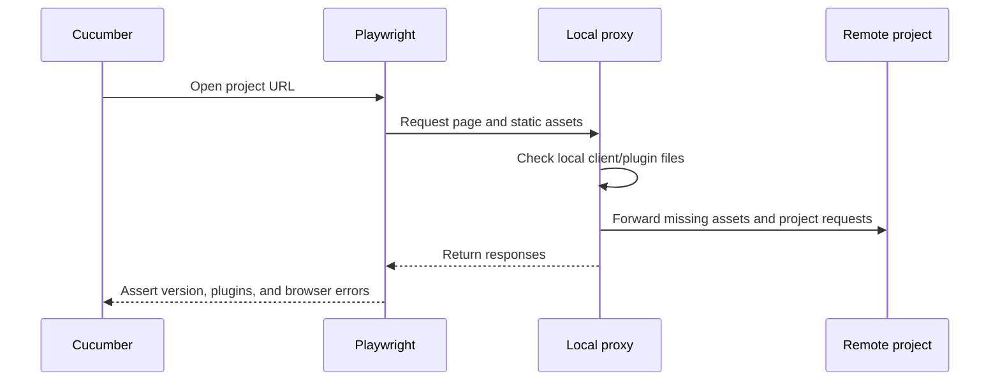

# BDD tests

The Cucumber scenarios in `features/` cover core services, utilities, Vue
components, directives, interactions, map controls, translations, geocoders,
and static resources. The separate `@smoke` scenarios exercise remote projects
through the local development proxy.

## Run

1. Run `npm run dev` and leave the development proxy at `http://localhost:3000`
   running.
2. In another terminal, run `npm test`.

The tests require network access to `dev.g3wsuite.it` and a Playwright Chromium
installation. The project already depends on Playwright; install its browser
with `npx playwright install chromium` if it is missing.

To run all offline scenarios, without the proxy or remote server:

```sh
node build/test.js --tags "not @smoke"
```

The browser scenarios use Playwright Chromium with local or in-memory fixtures
and blocked external requests. The `@unit` scenarios do not start a browser.
No additional npm commands are required.

| Feature | Behavior checked |
| --- | --- |
| `core.feature` | Events, lifecycle, localization, projections, plugins, selections, controls, SDK, shims and startup failure handling |
| `utils.feature` | Data manipulation, geometry, filters, exports, requests, storage and async helpers |
| `ui.feature` | Component methods/computed state, directives, interactions and control callbacks |
| `static.feature` | Localized labels, fixture-based geocoding, decoded/rendered images and fonts, stylesheet effects |
| `coverage.feature` | Source integrity, scenario-to-file associations and a 100% runtime function gate |
| `dev.g3wsuite.it.feature` | Remote project smoke tests (`@smoke`, requires the proxy) |

Behavioral coverage is tracked with `@covers:src/path/to/file.js` tags on
scenarios. Run `node build/test.js --tags "@file-coverage"` to list source files
without an associated scenario. The gate uses Cucumber's Gherkin parser, ignores
tags mentioned in comments/descriptions, and discovers every file under `src/`
except `src/plugins/`. Add tags only to scenarios exercising the file's behavior;
syntax checks do not qualify. This is a per-file association requirement, not a
statement of 100% line or branch coverage.

## Runtime function coverage

The full suite also requires **100% of source functions to execute**.
The inventory includes every `.js` file and Vue `<script>` block under `src/`,
except `src/plugins/`, even when a file is never imported. Assets have no
functions. Compiler-generated render functions and dependency code are not
part of this inventory.

Test loaders instrument the original code before esbuild transforms it.
Counters include declarations, arrows, callbacks, constructors, accessors,
public methods and private methods. The function-only Babel visitor is
intentional: Istanbul's default instrumenter omits private class methods.
Istanbul's coverage library combines counters from Node, VM fixtures and each
Chromium context. Vue script locations retain their original file line numbers.
Instrumentation applies only to tests, not development or production builds.

The `@function-coverage` scenario enables an `AfterAll` check, so the threshold
is evaluated after **all** selected scenarios, not when the feature happens to
run. A normal full run exits unsuccessfully if even one function has zero hits,
and writes `test/coverage/functions.json` with function names, source locations
and hit counts. This generated report is ignored by Git and rebuilt from the
current process; previous reports do not contribute coverage.

Run the entire offline suite to measure coverage:

```sh
node build/test.js --tags "not @smoke"
```

Running only `@coverage` or `@function-coverage` does not exercise the application
and will therefore fail the runtime gate. For focused behavioral debugging,
select the relevant feature, or use `--tags "not @smoke and not @function-coverage"`;
that diagnostic run does **not** certify full function coverage. Coverage
aggregation currently expects Cucumber's default serial execution.

Do not add tags or lower the threshold to resolve uncovered functions: add
behavioral scenarios that exercise them. Function execution coverage does not
prove that every branch was taken or that every function result was asserted.

Shared test loaders and browser fixtures live in `support/`; source modules are
executed without changing the production module format or writing test bundles
into the source tree. Runtime dependencies are replaced only where the tested
behavior needs a controlled input (for example map services or HTTP responses).

Add project examples to `features/dev.g3wsuite.it.feature` and their step
definitions to `steps/dev.g3wsuite.it.js`.




