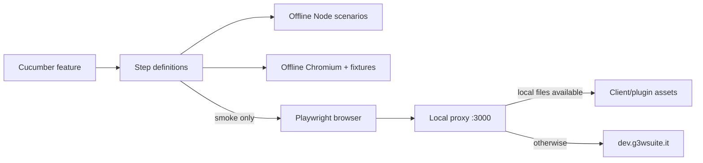
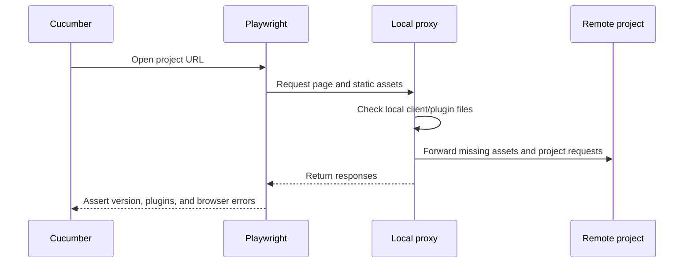

# BDD tests

The Cucumber scenarios in `features/` cover core services, utilities, Vue
components, directives, interactions, map controls, translations, geocoders,
and static resources. The separate `@smoke` scenarios exercise remote projects
through the local development proxy.

## Run

1. Run `npm run dev` and leave the development proxy at `http://localhost:3000`
   running.
2. In another terminal, run `npm test`.

The tests require network access to `dev.g3wsuite.it` and a Playwright Chromium
installation. The project already depends on Playwright; install its browser
with `npx playwright install chromium` if it is missing.

To run all offline scenarios, without the proxy or remote server:

```sh
node build/test.js --tags "not @smoke"
```

The browser scenarios use Playwright Chromium with local or in-memory fixtures
and blocked external requests. The `@unit` scenarios do not start a browser.
No additional npm commands or test dependencies are required.

| Feature | Behavior checked |
| --- | --- |
| `core.feature` | Events, lifecycle, localization, projections, plugins, selections, controls, SDK, shims and startup failure handling |
| `utils.feature` | Data manipulation, geometry, filters, exports, requests, storage and async helpers |
| `ui.feature` | Component methods/computed state, directives, interactions and control callbacks |
| `static.feature` | Localized labels, fixture-based geocoding, decoded/rendered images and fonts, stylesheet effects |
| `coverage.feature` | Source integrity and explicit scenario-to-file associations |
| `dev.g3wsuite.it.feature` | Remote project smoke tests (`@smoke`, requires the proxy) |

Behavioral coverage is tracked with `@covers:src/path/to/file.js` tags on
scenarios. Run `node build/test.js --tags "@coverage"` to list source files
without an associated scenario. The gate uses Cucumber's Gherkin parser, ignores
tags mentioned in comments/descriptions, and discovers every file under `src/`
except `src/plugins/`. Add tags only to scenarios exercising the file's behavior;
syntax checks do not qualify. This is a per-file association requirement, not a
statement of 100% line or branch coverage.

Shared test loaders and browser fixtures live in `support/`; source modules are
executed without changing the production module format or writing test bundles
into the source tree. Runtime dependencies are replaced only where the tested
behavior needs a controlled input (for example map services or HTTP responses).

Add project examples to `features/dev.g3wsuite.it.feature` and their step
definitions to `steps/dev.g3wsuite.it.js`.




