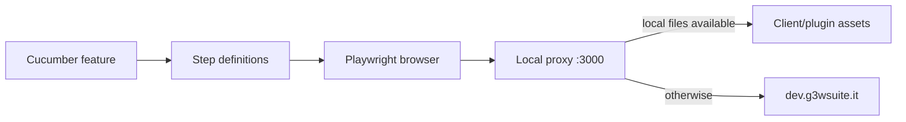
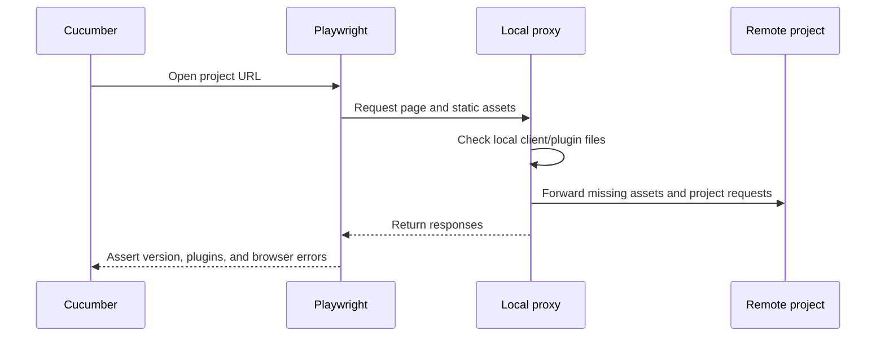

# BDD tests

The Cucumber scenarios in `features/` smoke-test the local client and plugin
assets against remote projects on `dev.g3wsuite.it`, routed through the local
development proxy. They verify the client version, plugin loading, browser
errors, and that at least one client asset is served from the local overrides
directory.

## Run

1. Run `npm run dev` and leave the development proxy at `http://localhost:3000`
   running.
2. In another terminal, run `npm test`.

The tests require network access to `dev.g3wsuite.it` and a Playwright Chromium
installation. The project already depends on Playwright; install its browser
with `npx playwright install chromium` if it is missing.

Run only the offline source-integrity and utility scenarios with
`node build/test.js --tags "@unit"`; these do not launch Playwright or contact
the remote server. The source-integrity scenario discovers and validates every
file under `src/`, except `src/plugins/`.

Behavioral coverage is tracked with `@covers:src/path/to/file.js` tags on
scenarios. Run `node build/test.js --tags "@coverage"` to list source files
without an associated scenario; this check fails until every non-plugin source
file has a coverage tag.

Add project examples to `features/dev.g3wsuite.it.feature` and their step
definitions to `steps/dev.g3wsuite.it.js`.

