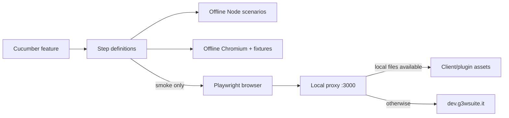
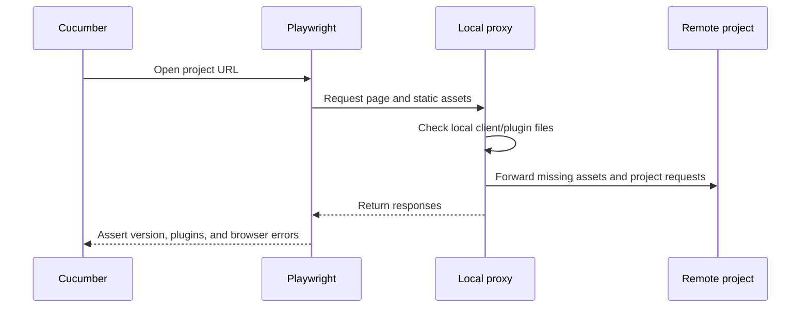

# BDD tests

The Cucumber scenarios in `features/` cover core services, utilities, Vue
components, directives, interactions, map controls, translations, geocoders,
and static resources. The separate `@smoke` scenarios exercise remote projects
through the local development proxy.

## Run

1. Run `npm run dev` and leave the development proxy at `http://localhost:3000`
   running.
2. In another terminal, run `npm test`.

The tests require network access to `dev.g3wsuite.it` and a Playwright Chromium
installation. The project already depends on Playwright; install its browser
with `npx playwright install chromium` if it is missing.

To run all offline scenarios, without the proxy or remote server:

```sh
node build/test.js --tags "not @smoke"
```

The browser scenarios use Playwright Chromium with local or in-memory fixtures
and blocked external requests. The `@unit` scenarios do not start a browser.
No additional npm commands are required.

The annotation drawing scenario waits for OpenLayers' deferred `singleclick`
before continuing, so a pending map selection cannot replace the saved-shape
list while Playwright is clicking it.

| Feature | Behavior checked |
| --- | --- |
| `bootstrap.feature` | Complete offline production startup with real project models, Vue and OpenLayers; registry filters/selection, catalog visibility and zoom, content navigation/docking/resizing, network events, plugin dependencies, GeoJSON/CSV/KMZ imports and persisted WMS/TMS connections |
| `sdk.feature` | Plugin compatibility: editable feature cloning, field/media classification, nested server validation messages, real Vue mixin lifecycle, mutually exclusive/range validation, Select2 service notifications and global date/range widgets |
| `annotations.feature` | Real point drawing, labels/styles, projected JSON downloads, visibility/editing/removal, imported annotation shapes and print entries |
| `core.feature` | Events, lifecycle, dialogs, galleries, localization, projections, plugins, selections, controls, SDK and startup failure handling |
| `layers.feature` | Layer metadata, relations, mutually exclusive catalog selections, scale-dependent visibility, local data requests, styles, GeoJSON/GML parsing and permalinks |
| `shims.feature` | Browser behavior for jQuery, Moment, Select2 and the date/time picker |
| `utils.feature` | Data manipulation, geometry, filters, exports, requests, storage and async helpers |
| `ui.feature` | Component methods/computed state, directives, interactions and control callbacks |
| `vue.feature` | One shared contract for every Vue file: independent data factories, computed caching, writable computed values and reactive updates with component-specific inputs/results |
| `forms.feature` | Mounted Vue fields, validation, autocomplete, relation filters, uploads, map picking, rich text, saved queries, bookmarks and dialogs |
| `query-results.feature` | Mounted query results, spatial summaries, nested forms and relations, action lifecycle, local pagination, sandboxed text/HTML and WMS info-format changes |
| `search.feature` | Configured search forms, cascading and cached choices, autocomplete ordering/cancellation, encoded filters, local search requests, related searches, follow-up forms and mobile dates/focus |
| `tables.feature` | Mounted attribute tables, local sorting/search/pagination, selection across pages, plugin actions, relations, map bounds, cleanup and HTTP-error recovery |
| `relations.feature` | Real relation menus and tables, parent previews, sorting/filtering/pagination, plugin actions, mounted forms, chart resizing/cleanup and export/error recovery |
| `geocoding.feature` | Dynamically loaded providers, projected coordinates, bounded local searches, synchronized map/query selection, lazy geometry, saved searches and draggable popovers |
| `notifications.feature` | Sequential alerts, persisted read preferences, manager toggles, unread badges, native popover dragging and keyboard dismissal |
| `map-controls.feature` | Real line/polygon drawing, point correction, measurement overlays, scale validation/synchronization and locally fulfilled Street View workflows |
| `menus.feature` | Mounted map/catalog menus, coordinate copying and querying, navigation, plugin entries, dragging/mobile dismissal, layer styles/filters, external layer colors/opacity/order, downloaded file contents, metadata and attribute tables |
| `static.feature` | Localized labels, fixture-based geocoding, decoded/rendered images and fonts, stylesheet effects |
| `coverage.feature` | Source integrity, 100% scenario-to-file associations and a 75% runtime function gate with exact-boundary regression checks |
| `dev.g3wsuite.it.feature` | Remote project smoke tests (`@smoke`, requires the proxy) |

Behavioral coverage is tracked with `@covers:src/path/to/file.js` tags on
scenarios. Run `node build/test.js --tags "@file-coverage"` to list source files
without an associated scenario. The gate uses Cucumber's Gherkin parser, ignores
tags mentioned in comments/descriptions, and discovers every file under `src/`
except `src/plugins/` and Git metadata named `.git`. Add tags only to scenarios exercising the file's behavior;
syntax checks do not qualify. This is a per-file association requirement, not a
statement of 100% line or branch coverage.

## Runtime function coverage

The full suite requires **at least 75% of source functions to execute**.
This is a temporary minimum, not the final goal: **100% remains the objective**
where the unchanged source permits it. The minimum allows continued behavioral
coverage work without disguising documented dead code or blocking source defects.
It also permits reachable gaps; it does **not** mean all remaining functions
are unreachable. The separate per-file scenario-association gate stays at 100%.
The inventory includes every `.js` file and Vue `<script>` block under `src/`,
except `src/plugins/`, even when a file is never imported. Assets have no
functions. Compiler-generated render functions and dependency code are not
part of this inventory.

Test loaders instrument the original code before esbuild transforms it.
Counters include declarations, arrows, callbacks, constructors, accessors,
public methods and private methods. The function-only Babel visitor is
intentional: Istanbul's default instrumenter omits private class methods.
Istanbul's coverage library combines counters from Node, VM fixtures and each
Chromium context. Vue script locations retain their original file line numbers.
Counter helpers have file-specific names so dynamically loaded classic scripts
cannot redirect existing functions into another file's counters. A regression
scenario checks delayed calls after a second script has loaded.
Instrumentation applies only to tests, not development or production builds.

The `@function-coverage` scenario enables an `AfterAll` check, so the threshold
is evaluated after **all** selected scenarios, not when the feature happens to
run. A normal full run exits unsuccessfully below the 75% minimum, or with an
empty inventory, and writes `test/coverage/functions.json` with function names, source locations
and hit counts. This generated report is ignored by Git and rebuilt from the
current process; previous reports do not contribute coverage.
The comparison uses exact covered/total counts, not the rounded display
percentage. Regression scenarios check an exact pass, a failing partial run,
a just-below-boundary value displayed as `75%`, and an empty inventory.
All functions, including documented inaccessible ones, remain in the report
and denominator; a successful run does not erase their zero counters.

Run the entire offline suite to measure coverage:

```sh
node build/test.js --tags "not @smoke"
```

Running only `@coverage` or `@function-coverage` does not exercise the application
and will therefore fail the runtime gate. For focused behavioral debugging,
select the relevant feature, or use `--tags "not @smoke and not @function-coverage"`;
that diagnostic run does **not** certify full function coverage. Coverage
aggregation currently expects Cucumber's default serial execution.

Do not add tags, fabricate hits or exclude functions to resolve coverage gaps:
add behavioral scenarios that exercise them. Any threshold reduction must be
explicitly documented; it does not make the remaining functions tested or
unreachable. Function execution coverage does not prove that every branch was
taken or that every function result was asserted.

### Shared Vue options contract

`vue.feature` discovers every `.vue` file in the source coverage scope and
requires a real compiled definition and valid inputs for each one. The same
contract creates two Vue instances using the source `props`, `data`, `computed`
and `methods` options. It checks per-instance local state, reads every computed
getter through Vue, then verifies expected values after a reactive change.
Writable computed properties are exercised through their public setter.

This deliberately isolates reactive options: it does not mount templates or
run lifecycle hooks and watchers. Mounted workflow scenarios remain responsible
for those integrations and for additional application-specific branches. Adding
a Vue file without registering its definition and contract inputs fails the
shared test. Data/computed functions are still instrumented normally; neither
their counters nor the runtime threshold receive special treatment.

### Known source issues deferred to future PRs (after #1010 has been merged)

Source files remain unchanged. The following issues were verified while adding
the behavioral tests and are **not** hidden by exclusions or artificial hits.
Source links below are immutable permalinks to the published source snapshot
`76f170d9088de58d91a5215a34d199adbd42c73c`, which matches the tested source tree.

| Source | Reproduction / consequence |
| --- | --- |
| [`g3w-state.js`](https://github.com/g3w-suite/g3w-client/blob/76f170d9088de58d91a5215a34d199adbd42c73c/src/g3w-state.js#L12), local `observe` helper | The helper and its proxy setter are declared but never used or exported. Normal application execution cannot exercise them. The code is retained. |
| [`Layer.getRelationAttributes`](https://github.com/g3w-suite/g3w-client/blob/76f170d9088de58d91a5215a34d199adbd42c73c/src/g3w-layer.js#L671) | Calling `layer.getRelationAttributes('missing')` throws `TypeError: this[#relations].find is not a function`. The private relation store is an object, not an array; the lookup callback never executes. |
| [`PluginService.unsubscribeEvent`](https://github.com/g3w-suite/g3w-client/blob/76f170d9088de58d91a5215a34d199adbd42c73c/src/g3w-plugin.js#L524) | Subscribe an event with `subscribeEvent({ name: 'updated', owner: 'subscriber', listener() {} })`, then unsubscribe it. This throws `TypeError: this.removeEvent is not a function`; the inherited emitter provides `off`, not `removeEvent`. `unsubscribeAllEvents` and `clearAllEvents` also use this broken cleanup path when subscriptions exist. |
| [`splitFeature`, 3D lines](https://github.com/g3w-suite/g3w-client/blob/76f170d9088de58d91a5215a34d199adbd42c73c/src/utils/splitFeature.js#L168) | Splitting `LineString([[0, 0, 8], [10, 0, 9]])` with `LineString([[5, -1], [5, 1]])` fails while parsing `LINESTRING(0 0 8,10 0 9)`: removing the WKT `Z` marker leaves the third ordinates behind. Execution never reaches the [Z-restoration callback](https://github.com/g3w-suite/g3w-client/blob/76f170d9088de58d91a5215a34d199adbd42c73c/src/utils/splitFeature.js#L226). |
| [`splitFeature`, polygon results](https://github.com/g3w-suite/g3w-client/blob/76f170d9088de58d91a5215a34d199adbd42c73c/src/utils/splitFeature.js#L134) | The Polygonizer returns individual Polygons, which the parser writes as single geometries. Valid polygon splits therefore cannot execute the multi-geometry callback in this branch. |
| [Date/time picker limit getters](https://github.com/g3w-suite/g3w-client/blob/76f170d9088de58d91a5215a34d199adbd42c73c/src/shims/datetimepicker.js#L431) | After clearing limits with `minDate(false)` / `maxDate(false)`, the corresponding getters can throw: `false?.clone()` still attempts to call the missing `clone` method. |
| [Date/time picker `today` / `clear` callbacks](https://github.com/g3w-suite/g3w-client/blob/76f170d9088de58d91a5215a34d199adbd42c73c/src/shims/datetimepicker.js#L314) | These callbacks have no corresponding widget actions, so the real widget cannot invoke them. They remain uncovered rather than being called artificially. |
| [Query results JSON info-format changes](https://github.com/g3w-suite/g3w-client/blob/76f170d9088de58d91a5215a34d199adbd42c73c/src/components/QueryResults.vue#L1157) | Changing a raw-text result to `application/json`, using a local proxy returning a valid GeoJSON FeatureCollection, logs `TypeError: Cannot read properties of undefined (reading 'layer')` and leaves the original raw text and empty feature list. `changeInfoFormat` omits `projections`, which the [JSON parser](https://github.com/g3w-suite/g3w-client/blob/76f170d9088de58d91a5215a34d199adbd42c73c/src/g3w-layer.js#L3442) dereferences. The successful format-switch scenario uses the supported text/GML path; it does not treat the JSON failure as desired behavior. |
| [Search service all-values filter](https://github.com/g3w-suite/g3w-client/blob/76f170d9088de58d91a5215a34d199adbd42c73c/src/components/g3w-search.js#L163) | Initialize a `selectfield` with attribute `kind` and operator `in`, leave its default all-values selection, then call `panel.getService().createFilter()`. It returns `['kind\|in\|(__G3W_ALL__)']`: the scalar-only exclusion does not recognize the array `['__G3W_ALL__']` and serializes the internal sentinel as a real value. The separate `doSearch` path checks individual array elements correctly. |
| [Iframe projected coordinates](https://github.com/g3w-suite/g3w-client/blob/76f170d9088de58d91a5215a34d199adbd42c73c/src/g3w-iframe.js#L156) | Call `app:zoomtocoordinates` with `{ coordinates: [10, 20], epsg: 3857 }`. After resolving the projection, it throws `ReferenceError: coordinates is not defined`: the local variable is named `coords`. |
| [Iframe default feature-search layers](https://github.com/g3w-suite/g3w-client/blob/76f170d9088de58d91a5215a34d199adbd42c73c/src/g3w-iframe.js#L216) | Omit `qgs_layer_id` with a configured spatial layer. The default mapping produces objects rather than layer IDs (and reads `id` / `name` directly from layer instances). The ID-based lookup cannot resolve them, so the command returns `null` and zooms to the initial extent without searching that layer. Explicit-ID scenarios exercise the real search pipeline instead. |
| [Table relation highlighting](https://github.com/g3w-suite/g3w-client/blob/76f170d9088de58d91a5215a34d199adbd42c73c/src/components/Table.vue#L406) | A feature without geometry returns immediately; one with geometry either highlights directly or returns at the next guard. Consequently the [relation-query callbacks](https://github.com/g3w-suite/g3w-client/blob/76f170d9088de58d91a5215a34d199adbd42c73c/src/components/Table.vue#L430) are unreachable for ordinary feature objects. No fixture changes geometry between reads to bypass these guards. |
| [Table post-destruction placeholder](https://github.com/g3w-suite/g3w-client/blob/76f170d9088de58d91a5215a34d199adbd42c73c/src/components/Table.vue#L705) | Full-size cleanup assigns an empty `async_highlight` closure after destroying the component. Normal live-component interaction cannot invoke this replacement; the cleanup scenarios verify its observable map effects without calling dead placeholders. |
| [Table search ordering](https://github.com/g3w-suite/g3w-client/blob/76f170d9088de58d91a5215a34d199adbd42c73c/src/components/Table.vue#L535) | Sort the second column, then use global search. `getData({ search })` defaults its ordering index to zero, so the request sorts the first column while `ordering` and the highlighted header still indicate the second. The successful combined sorting/search scenario explicitly selects the first column before searching. |
| [Geocoding clear selection](https://github.com/g3w-suite/g3w-client/blob/76f170d9088de58d91a5215a34d199adbd42c73c/src/static/map-controls/geocoding.js#L221) | Submit the trash action after selecting a result. It clears the vector source, then throws `TypeError: Cannot read properties of undefined (reading 'find')`: `GUI.getState().layers` does not exist (`queried_layers` is the current store). `clearing` remains `true`; the following result-cleanup callbacks are not reached. |
| [Geocoding automatic updates](https://github.com/g3w-suite/g3w-client/blob/76f170d9088de58d91a5215a34d199adbd42c73c/src/static/map-controls/geocoding.js#L439) | The update-on-move checkbox is inside an always-hidden list item, so users cannot enable retained-selection/deduplication behavior. The [view listener](https://github.com/g3w-suite/g3w-client/blob/76f170d9088de58d91a5215a34d199adbd42c73c/src/static/map-controls/geocoding.js#L144) also subscribes to generic `change`, whereas normal center/resolution updates emit property-specific events. Tests verify normal map movement does not send extra requests; they do not expose hidden controls or call the listener artificially. |
| [Many-to-many relation results](https://github.com/g3w-suite/g3w-client/blob/76f170d9088de58d91a5215a34d199adbd42c73c/src/components/Relations.vue#L517) | A relation request can return valid link records and the referenced-layer request can return two valid features, yet the table stays empty. In `await GUI.getData(...)?.data?.[0]?.features`, property access applies to the Promise before it is awaited, so the resolved features and their mapping callbacks are never used. The tests do not replace the real async API with a synchronous fixture to bypass this defect. |
| [Annotation point print labels](https://github.com/g3w-suite/g3w-client/blob/76f170d9088de58d91a5215a34d199adbd42c73c/src/static/map-controls/annotation.js#L682) | Import a Point with `text: 'Saved Point'` and `show_text: true`, then obtain `GUI.getPrintParams({})`. Its print label is empty: the point branch reads flags from `feat` after they were unset, whereas other shape branches read the original `f`. Tests verify that all print entries survive and other shapes retain their labels; they do not assert that the missing point label is correct. |

These are not an exhaustive list of uncovered functions. The current report
also includes reachable behavior for which scenarios still need to be written.
The temporary runtime minimum is 75%; reaching 100% would additionally require
covering the remaining reachable paths and addressing blocking source defects.
Do not patch source methods in a test fixture merely to execute an otherwise
unreachable callback.

#### Identifying unreachable functions

The following inventory distinguishes specific inaccessible callbacks from
entire methods that can still be entered. Locations use the original source
and anonymous names are those emitted by the function-coverage report.

| Classification | Functions | Evidence |
| --- | --- | --- |
| Unused local code | `observe` (`anonymous_0`, 12:17) and proxy `set` (13:3) | [`observe`](https://github.com/g3w-suite/g3w-client/blob/76f170d9088de58d91a5215a34d199adbd42c73c/src/g3w-state.js#L12) is neither called nor exported; only that helper can construct the proxy containing [`set`](https://github.com/g3w-suite/g3w-client/blob/76f170d9088de58d91a5215a34d199adbd42c73c/src/g3w-state.js#L13). |
| Blocked by an earlier exception | Relation lookup callback (`anonymous_65`, 672:33) | [`getRelationAttributes`](https://github.com/g3w-suite/g3w-client/blob/76f170d9088de58d91a5215a34d199adbd42c73c/src/g3w-layer.js#L672) calls nonexistent `.find` on its private object store. The method itself is **not** classified as unreachable. |
| Contradictory guards | Six Table relation callbacks (`anonymous_21` through `anonymous_26`) | The [guard](https://github.com/g3w-suite/g3w-client/blob/76f170d9088de58d91a5215a34d199adbd42c73c/src/components/Table.vue#L406) returns for both geometry cases before callbacks at [430](https://github.com/g3w-suite/g3w-client/blob/76f170d9088de58d91a5215a34d199adbd42c73c/src/components/Table.vue#L430), [431](https://github.com/g3w-suite/g3w-client/blob/76f170d9088de58d91a5215a34d199adbd42c73c/src/components/Table.vue#L431), [438](https://github.com/g3w-suite/g3w-client/blob/76f170d9088de58d91a5215a34d199adbd42c73c/src/components/Table.vue#L438), [444](https://github.com/g3w-suite/g3w-client/blob/76f170d9088de58d91a5215a34d199adbd42c73c/src/components/Table.vue#L444), [459](https://github.com/g3w-suite/g3w-client/blob/76f170d9088de58d91a5215a34d199adbd42c73c/src/components/Table.vue#L459), and [460](https://github.com/g3w-suite/g3w-client/blob/76f170d9088de58d91a5215a34d199adbd42c73c/src/components/Table.vue#L460) for ordinary stable feature objects. |
| No widget action | Date-picker `today` / `clear` (`anonymous_42`, 314:27; `anonymous_43`, 315:27) | The [callbacks](https://github.com/g3w-suite/g3w-client/blob/76f170d9088de58d91a5215a34d199adbd42c73c/src/shims/datetimepicker.js#L314) have no rendered action; ordinary widget interaction cannot dispatch them. |
| Incompatible upstream result / parsing failure | Polygon multi-geometry callback (`anonymous_9`, 134:51); Z restoration (`anonymous_11`, 226:31) | The [polygon result branch](https://github.com/g3w-suite/g3w-client/blob/76f170d9088de58d91a5215a34d199adbd42c73c/src/utils/splitFeature.js#L134) receives individual polygons; the [Z callback](https://github.com/g3w-suite/g3w-client/blob/76f170d9088de58d91a5215a34d199adbd42c73c/src/utils/splitFeature.js#L226) follows the failing 3D WKT parse described above. |

These are documented limitations, **not coverage exclusions**. They remain in
the denominator and retain their actual zero counters. Other zero-hit functions
must not be called unreachable without an equivalent source-level explanation.

In particular, zero-hit Vue event handlers, watchers and lifecycle hooks are
**untested, not proven unreachable**. They require appropriate component props,
configuration, mounting and native UI events. For example,
[`App.logout`](https://github.com/g3w-suite/g3w-client/blob/76f170d9088de58d91a5215a34d199adbd42c73c/src/components/App.vue#L1035)
is reachable through the account link once `initConfig.user.logout_url` is
provided; it was previously uncovered, not dead code.
`@header-workflows` exercises
the rendered account/logout and accessibility actions, custom modal dismissal,
and the language radio's `v-model` / translation watcher without calling those
methods directly. Logout checks both successful POST/reload and rejected POST
without reload, including the CSRF header and exact expected error diagnostics.
Coverage is collected before successful navigation discards the original page;
the logged-out response is then asserted and its uninstrumented page closed.

#### Reachable handlers activated by Vue application state

The `@vue-state-workflows` scenarios verify these additional cases through the
running production App. They are **reachable**, not source-code limitations:

| Required state | Native interaction and verified behavior | Source |
| --- | --- | --- |
| `map_themes.project` contains a theme and matching layer styles/tree | Selecting its radio triggers the active-theme watcher, lazily fetches configuration, changes the layer style, hides the configured layer and collapses its group. | [`getThemeConfig` / `changeTheme`](https://github.com/g3w-suite/g3w-client/blob/76f170d9088de58d91a5215a34d199adbd42c73c/src/components/App.vue#L1403) |
| A user ID makes `ApplicationState.logged` true | The custom-theme controls become available. Form submission rejects duplicate names, saves a new theme, updates its expansion state, then cancels or confirms deletion. Dialog opening/closing and theme selection exercise the actual Vue watchers. | [`saveTheme` / `updateTheme` / `deleteTheme`](https://github.com/g3w-suite/g3w-client/blob/76f170d9088de58d91a5215a34d199adbd42c73c/src/components/App.vue#L1589), [watchers](https://github.com/g3w-suite/g3w-client/blob/76f170d9088de58d91a5215a34d199adbd42c73c/src/components/App.vue#L1801) |
| Sidebar panels exist, including a nested plugin-style panel | Opening the legend activates the ownership watcher and disables unrelated menu items. Clicking its collapsed owner reveals the existing panel without duplicating it; native back/close controls unmount the stack and restore menu interaction. | [`panels.length` watcher](https://github.com/g3w-suite/g3w-client/blob/76f170d9088de58d91a5215a34d199adbd42c73c/src/components/App.vue#L1708), [panel controls](https://github.com/g3w-suite/g3w-client/blob/76f170d9088de58d91a5215a34d199adbd42c73c/src/components/App.vue#L1214) |
| The external catalog contains imported layers | The group appears after two actual file imports. Mouse/keyboard controls collapse/expand it, toggle both real map layers and remove them together. | [External group handlers](https://github.com/g3w-suite/g3w-client/blob/76f170d9088de58d91a5215a34d199adbd42c73c/src/components/App.vue#L1359) |

Theme updates are enabled only for the currently selected theme. Changing
layer visibility clears that selection; the update scenario therefore changes
group expansion, which preserves the selected theme, rather than force-clicking
a disabled control. Theme HTTP responses match the real project tree structure;
only server data is supplied, not replacement App methods.

Shared test loaders and browser fixtures live in `support/`; source modules are
executed without changing the production module format or writing test bundles
into the source tree. Runtime dependencies are replaced only where the tested
behavior needs a controlled input (for example map services or HTTP responses).

The `@form-workflows` scenarios mount the real compiled Vue components, observe
their input schemas as a parent form would, and use real OpenLayers geometries,
interactions and DOM selections. Local HTTP responses provide options, relation
data, uploads and metadata; map/service fixtures supply only the dependencies
needed by each workflow. Both browser errors and Vue lifecycle/watcher errors
fail the scenario.

The `@application-bootstrap` scenarios execute `index.prod.js` after registering
offline server configuration and local asset routes. Project methods, GUI
services, the root App, catalog, dialogs and the OpenLayers map are the actual
implementations, not replacement methods. Native pointer/keyboard events drive
the catalog, content controls and add-layer dialog; local responses provide WMS
configuration, map images and a third-party plugin with a script dependency.
File uploads use real browser `File` objects and a real compressed KML archive.
Unexpected application warnings, request errors and Vue/browser errors fail
each scenario. The exact Chromium Canvas2D advisory recommending
`willReadFrequently` is retained in the collected messages but is not treated
as an application error; no application warning category is suppressed.

The `@context-menu-workflows` scenarios reuse real map events, layer models,
stylesheets and font assets. Native pointer/keyboard input drives the menus and
color picker; local HTTP responses supply styles, filter tokens and downloads.
The copy event is intercepted to verify the selected text without overwriting
the system clipboard. Map-tool hosts and metadata tabs are controlled boundaries;
attribute tables open through the real layer method and mount the real component.

The `@query-results` scenarios reuse these mounted-component fixtures and real
layer models. The actual GUI normalizes responses, creates actions and clears
query state; only map outputs and external service boundaries are controlled.
Local HTTP fixtures exercise pagination and WMS proxy requests. Related-feature
boxes are checked independently, including resetting their state for a new
response. Iframe checks verify plain-text escaping, content-driven sizing and
confirmation before opening HTML links.

The `@search-workflows` scenarios mount the actual search panel and service.
Real layer methods and the GUI search pipeline send requests to local HTTP
fixtures; only presentation outputs, map effects and user notifications are
controlled. Native custom-select events, form submission and date-picker
events update the search configuration. Autocomplete races use a held HTTP
response, not artificial coverage hits or source-method replacements. Console
warnings, failed requests and Vue/browser errors fail these scenarios.

The `@attribute-tables` scenarios mount the actual table with real layer models,
GUI selection state and OpenLayers geometries. Local HTTP fixtures implement
ordering, global/column filters, pagination and selected-feature lookup. Map
presentation and host layout boundaries are controlled, while an HTTP 500 case
checks the actual error notification, preserved rows and successful retry.

The `@notification-workflows` scenarios initialize alerts through the real
application-ready event and registered navbar action. Native popovers, bubbling
DOM events and localStorage exercise the private alert lifecycle without
calling private callbacks directly.

The `@map-control-workflows` scenarios load original instrumented map controls
into a rendered OpenLayers map with its real stylesheet and footer padding.
Real Draw interactions, native pointer/keyboard events and the GUI custom-select
update line/polygon tooltips and release layers/overlays when disabled. Scale
entry checks valid/invalid values, custom-option replacement, predefined scales
and replacing the map view. The Street View script, preliminary image request
and marker image are fulfilled locally; the vendor fixture emits position and
heading changes and rejects unavailable panoramas. Tests check public URLs,
marker coordinates/rotation, recentering, warning propagation and cleanup.
Map registration/lookup and vendor/GUI presentation boundaries are controlled;
production control methods and private state are not replaced.

The `@geocoding-workflows` scenarios reuse the rendered map fixture. The control
dynamically loads the original Nominatim provider from a locally fulfilled
script; local HTTP responses exercise geographic bounds and address metadata.
A custom provider fixture supplies lazy polygon geometry, missing geometry and
network failures through real requests. The real GUI normalizes selected
features and propagates query-result removal back to the marker layer.
Saved-search actions and the content/map presentation are host boundaries.

The `@relation-workflows` scenarios enter through the real `GUI.showRelations`
and `Component` wrapper rather than supplying invented component state. The
content host mounts the actual relation views and generated attribute forms.
Real layer methods construct relation/export URLs; HTTP fixtures implement
sorting, filters and pagination. Downloads assert the CSV filename and bytes,
including an HTTP-error retry. External chart rendering is controlled, while
native resize events and component destruction exercise chart cleanup.

Add project examples to `features/dev.g3wsuite.it.feature` and their step
definitions to `steps/dev.g3wsuite.it.js`.




